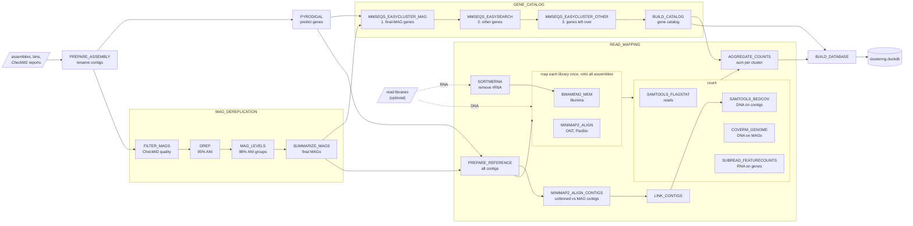

[](https://www.nextflow.io/)
[](https://docs.conda.io/en/latest/)
[](https://www.docker.com/)
[](https://sylabs.io/docs/)

```
         __              __
  _____ / /__  __ _____ / /_ ___   _____ ____ ___   ____ _
 / ___// // / / // ___// __// _ \ / ___// __ `__ \ / __ `/
/ /__ / // /_/ /(__  )/ /_ /  __// /   / / / / / // /_/ /
\___//_/ \__,_//____/ \__/ \___//_/   /_/ /_/ /_/ \__, /
                                                 /____/

Dereplicate MAGs and genes from metagenomes

     Github: https://github.com/dsamoht/clustermg
     Version: v2.0.0
```

## tl;dr
```bash
nextflow run dsamoht/clustermg --help # nextflow pulls the repo automatically
```

## How it works
Inputs :
  1) assemblies (fasta) 
  2) corresponding MAGs (fasta or "contig2bin" .txt file). 
  3) MAGs statistics from CheckM2  
  4) (optional) DNA reads 
  5) (optional) RNA reads 

clustermg build: 
- one final set of MAGs, dereplicated with dRep after a CheckM2 quality filter;
- one gene catalog of every gene of every assembly, dereplicated with MMseqs2, in which the genes of the final MAGs are only ever represented by a final MAG gene;
- (optional) features (MAGs, genes) abundance/expression level matrices when reads libraries are provided; 
- (experimental) one DuckDB database and a local application to ease results exploration.

## pipeline overview



## software dependencies

- Nextflow
- a container engine (i.e. docker/singularity) or conda

## documentation

Full documentation: [usage](./docs/usage.md).  
Pipeline outputs: [output](./docs/output.md).
